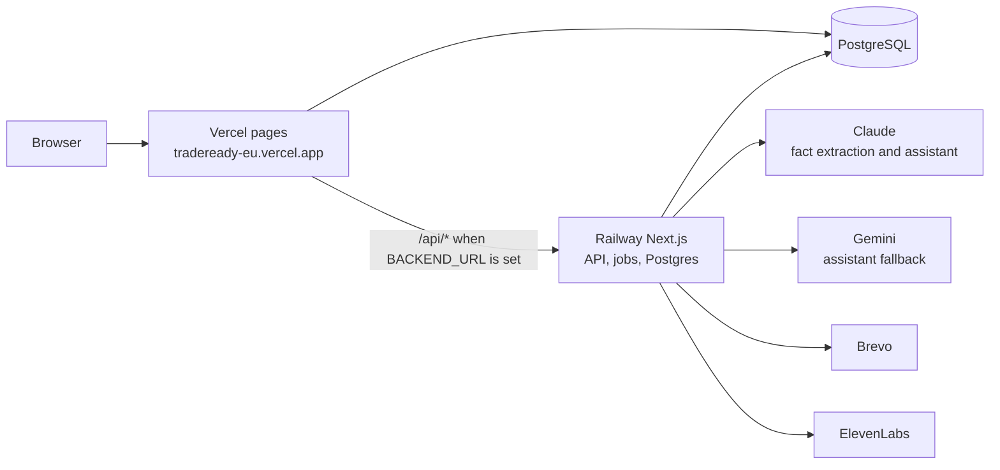
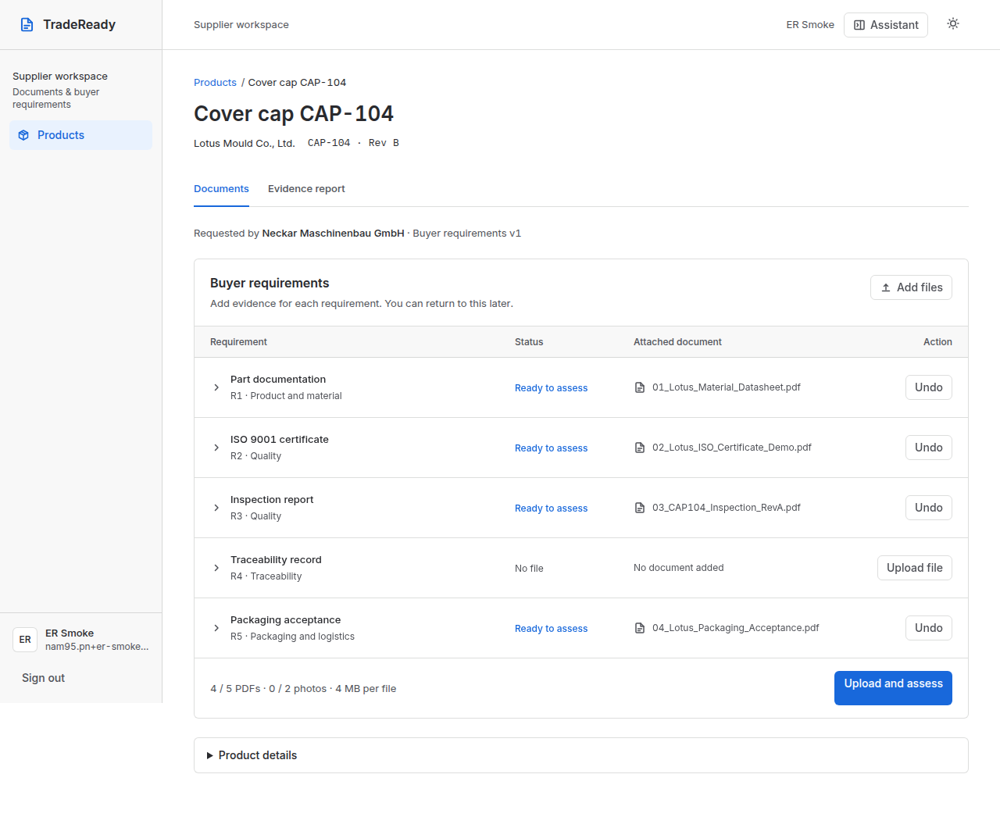
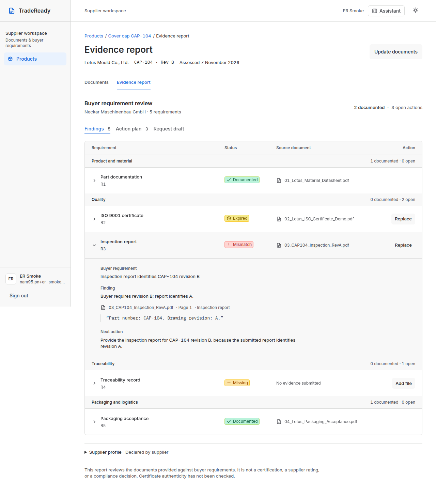
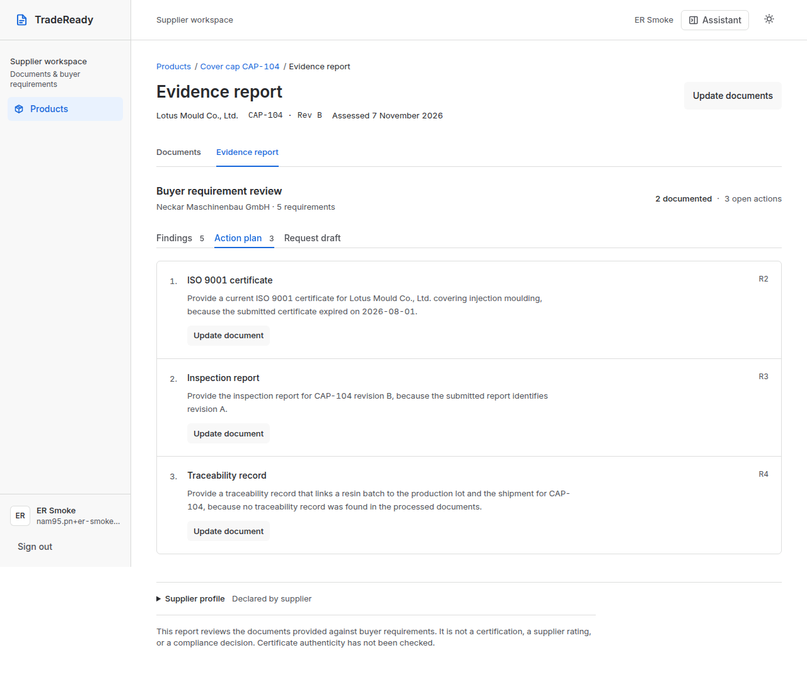
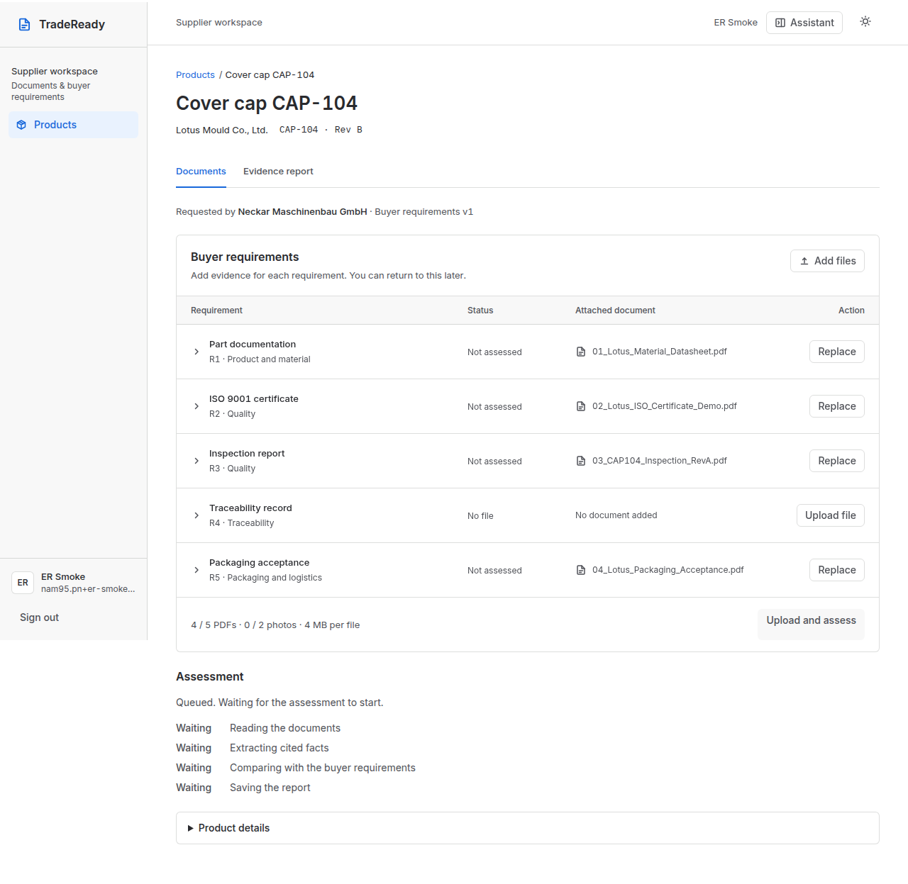

<p align="center"></p>

# TradeReady

**From Supplier Potential to Buyer Confidence.**

TradeReady is a supplier and buyer workspace for one checklist. A supplier uploads documents. The app reads the text, keeps exact quotes, and applies deterministic rules. The buyer sees the shared report: what is documented, what is still open, and what to provide next. The model does not decide a status, and the report has no score.

This is the Stuttgart hackathon build for 2026-11-07. The description below matches `main` at `218f79f`.

## What it does

One account can use both workspaces and switch in the header.

**Supplier workspace** (`/workspace`). The supplier declares a profile (company, country, category, capabilities, target market), labelled "declared by supplier". They create a product, attach PDFs (up to 8 active, plus 2 photos, 4 MB each), and start an assessment. A job runs in the background: page text, then fact extraction, then rules. The same set of file bytes returns the existing job.

**Buyer workspace** (`/buyer`). The buyer sees open-request, connected-product, and shared-report counts, posts a request, and searches listed products by name, part number, or company, with category and country filters. "Request evidence" opens a connection. A shared connection has "View report".

**Connections.** The supplier board lists open requests (organisation, title, part number, checklist — not an email). The supplier responds with a product. Either side can start a connection. The supplier shares one completed result. Each party has its own inbox. A third account cannot open the connection.

**Shared report.** Status per requirement (`DOCUMENTED`, `MISSING`, `MISMATCH`, `EXPIRED`, `NEEDS_REVIEW`), the evidence type, a reason, a next action, and citations (filename, page, exact quote). The buyer view is read-only and has no document links. The footer states that the report is not a certification and that certificate authenticity has not been checked.

**Action plan.** Counts per dimension (Quality, Product and material, Traceability, Packaging and logistics) and one action per open finding, in requirement order. A plain-text document request can be copied. TradeReady does not send that draft. There is no percentage.

New products use checklist `neckar-cap-104-qualification` (the organisers' TC01 pack, R1–R6). Products created earlier keep `neckar-cap-104` (the fictional CAP-104 demo, R1–R5).

The assistant sits on the supplier workspace, the buyer workspace, and `/dashboard`. With `ANTHROPIC_API_KEY` it calls Claude and falls back to Gemini if that call fails. Without the key it calls Gemini only. Steps that email another company or publish a listing, request, response, or share return a confirm card. Nothing is written until the user presses Send. Spoken replies use ElevenLabs when `ELEVENLABS_API_KEY` is set. Otherwise the reply stays text.

Sign-in is email and password. "Email me a sign-in link" sends mail through Brevo. Google and GitHub appear only when both client values for that provider are set.

## Architecture



Vercel serves pages. When `BACKEND_URL` is set, `next.config.ts` rewrites `/api/*` to Railway before the app's own API routes. Railway runs the Next.js server, `after()` job runner, and Postgres, and runs `pnpm db:migrate` before start. Locally `BACKEND_URL` is unset, so the dev server handles `/api/*` itself.

Fact extraction calls Claude (`ANTHROPIC_MODEL`, default `claude-haiku-5-5`). The assistant prefers Claude and falls back to Gemini (`GEMINI_MODEL`, production value in `.env.example` is `gemini-3.6-flash`). Brevo sends the assessment-ready mail, connection notices, and magic-link mail. ElevenLabs is optional text-to-speech (stock voice, server-side key).

## Demo

Checked on 2026-11-07:

- <https://tradeready-eu.vercel.app> returned HTTP 200. The home page title is TradeReady, with the current text ("Add the documents a buyer asked for…") and the line "The report is an evidence review. It is not a certification." Signed-out `/workspace` redirected to `/sign-in?next=%2Fworkspace`. The sign-in page offers a password and "Email me a sign-in link".
- <https://exportready.vercel.app> redirects to that host.
- <https://exportready-production.up.railway.app> returned HTTP 404, body `{"status":"error","code":404,"message":"Application not found"}`. `GET /api/health` on the Vercel origin is rewritten to Railway and returned the same 404 (`x-railway-fallback: true`). The API was not up on that host at the time of this check.

The roadmap page is a separate Vercel project: <https://exportready-roadmap.vercel.app> (HTTP 200).

## Tech stack

| Piece | Choice |
|---|---|
| App | Next.js 16 (App Router), React 19, Tailwind CSS 4 |
| Auth | Better Auth 1.7 (email and password, magic link; Google and GitHub when configured) |
| Database | PostgreSQL 16, Drizzle ORM, `postgres` driver |
| Validation | Zod 4 |
| Documents | `unpdf` for page text |
| Models | `@anthropic-ai/sdk` for fact extraction and the assistant; `@google/genai` as the assistant fallback |
| Email | Brevo over `fetch` (`POST /v3/smtp/email`). No Brevo SDK |
| Voice | ElevenLabs text-to-speech when `ELEVENLABS_API_KEY` is set |
| Quality | TypeScript, Biome, Vitest against PostgreSQL |
| Package manager | pnpm 11.6. Node 22.12 or newer |
| Hosts | Vercel (pages), Railway (server, jobs, Postgres) |

Versions are the ranges in `package.json`.

## Local setup

Docker, Node 22.12+, and pnpm 11.

```bash
pnpm install
pnpm dev:setup
pnpm dev
```

Open <http://localhost:3001>. `pnpm dev:setup` writes `.env` with a fresh `BETTER_AUTH_SECRET`, starts PostgreSQL on port 5434, migrates, seeds the demo user, and installs git hooks. The seeded account is `SEED_USER_EMAIL` and `SEED_USER_PASSWORD` in `.env`.

Leave `BACKEND_URL` unset locally. Do not point `DATABASE_URL` at Railway or any shared database.

| Command | What it does |
|---|---|
| `pnpm dev` | Dev server on `PORT` from `.env` (3001 in the main checkout) |
| `pnpm verify` | Typecheck, lint, and tests. The pre-push hook and CI run this |
| `pnpm test:golden` | Live model check of the fixture answer key. Not part of `pnpm verify` |
| `pnpm db:up` | PostgreSQL in Docker on port 5434 |
| `pnpm db:generate` | New migration after a schema change |
| `pnpm db:migrate` / `pnpm db:seed` | Apply migrations / create the demo user |
| `pnpm worktree <type>/<slug>` | Feature branch in its own worktree, database, and port |

Copy new keys into `src/env.ts` and `.env.example` only. Never commit `.env`.

Optional variables, all blank until that feature is used:

| Variable | Used for |
|---|---|
| `ANTHROPIC_API_KEY` | Fact extraction and the assistant |
| `ANTHROPIC_MODEL` | Defaults to `claude-haiku-5-5` when unset |
| `ANTHROPIC_WORKSPACE_ID` | Sent as `anthropic-workspace-id` when the key is not workspace-scoped |
| `GEMINI_API_KEY`, `GEMINI_MODEL` | Assistant when Claude is unset or the Claude call fails |
| `BREVO_API_KEY`, `BREVO_SENDER_EMAIL` | Assessment mail, connection notices, magic links |
| `APP_BASE_URL` | Origin in the assessment email link |
| `ELEVENLABS_API_KEY` | Spoken assistant replies |
| `BACKEND_URL` | Vercel only. Railway origin for the `/api/*` rewrite |
| `RAILWAY_PUBLIC_DOMAIN` | Set by Railway. Sign-in trusts `https://` that host |
| `GOOGLE_CLIENT_ID` / `GOOGLE_CLIENT_SECRET`, `GITHUB_CLIENT_ID` / `GITHUB_CLIENT_SECRET` | Social sign-in, both values required |

`DATABASE_URL`, `BETTER_AUTH_SECRET` (at least 32 characters), and `BETTER_AUTH_URL` are required at startup.

## Deployment

Two projects, both from `main`. Steps, env placement, and rollback are in [docs/deploy.md](docs/deploy.md).

- **Railway** (`railway.json`): Node 22, build `pnpm build`, pre-deploy `pnpm db:migrate`, start `pnpm start`, healthcheck `GET /api/health`. Private `DATABASE_URL`. Model, Brevo, and ElevenLabs keys live here. `BACKEND_URL` stays unset.
- **Vercel**: build `node scripts/vercel-build.mjs` (build only, no migrate). `BACKEND_URL` is the Railway origin. `DATABASE_URL` is Railway's public Postgres URL. `BETTER_AUTH_SECRET` matches Railway.

The page host that answered on 2026-11-07 is <https://tradeready-eu.vercel.app>. The Railway hostname in `docs/deploy.md` did not (see [Demo](#demo)).

## Fixtures

`fixtures/exportready/` holds fictional one-page PDFs for Lotus Mould Co., Ltd. and buyer Neckar Maschinenbau GmbH, part CAP-104. Every page except `empty.pdf` ends with `FICTIONAL DEMO DOCUMENT - NOT VALID FOR COMMERCIAL USE`. Regenerate them with `pnpm exec tsx scripts/make-fixtures.ts`.

`answer-key.json` is test-only. Do not send it, or any expected outcome in it, to the model. Baseline documents 01–04 expect R1 documented, R2 expired (certificate valid until 2026-08-01, assessed 2026-11-07), R3 mismatch (inspection revision A against required B), R4 missing, R5 documented. Replacing 03 with 05 changes only R3. See [fixtures/exportready/README.md](fixtures/exportready/README.md).

`fixtures/test-pack/tc01/` is the organisers' pack (buyer requirements plus six evidence PDFs) for checklist `neckar-cap-104-qualification`.

## Tests

Run on 2026-11-07 in a worktree of `main` `218f79f`, against PostgreSQL 16:

| Command | Result |
|---|---|
| `pnpm typecheck` | Passed |
| `pnpm lint` | Exit 0. One existing warning: unused parameter in `src/components/workspace/documents.ts` |
| `pnpm test` | 34 files, 171 tests, all passed |

`pnpm test:golden` was not run. It calls the live model and is not part of `pnpm verify`. The golden pass recorded in the task notes used Gemini, before fact extraction moved to Claude. No Claude or Gemini key was set for this run.

The suite covers, among other cases: sign-up and sign-in, magic-link mail, PDF text of the fixtures, citation drops, rule decisions (expiry, revision, wrong part), one job per document snapshot, another user's job returning 404, the assistant (including a foreign product id and the five-round cap), connection access (the buyer sees the shared result, a third user gets 404, a duplicate connection and a shared status without a result are rejected), buyer catalog filters, and the report summary counts and action plan.

## Screenshots

Supplier workspace, evidence report, and action plan for the fictional CAP-104 demo checklist (`neckar-cap-104`). These files were already in `docs/screenshots/`.









## Team

From `docs/exportready-passport-idea.md` and `git shortlog` on this repository. No role is filled in beyond those sources.

- **Nam** (GitHub `namnhatpham1995`). Most commits on `main`, including the assessment pipeline, uploads and jobs, buyer-supplier connections, the assistant, Claude extraction, and deployment.
- **Matvii Nesterenko** (GitHub `kapustazh`). Supplier workspace UI, buyer workspace pages, passport branding, and buyer/supplier navigation.
- **Phuong.** Named with Nam in the idea document. No commits under that name. Customer-discovery notes assigned to Phuong in `docs/pitch/customer-learning.md` are still empty.

## Known limits

- **Durability.** The runner is `after()` on the Railway process. A job stuck in `PROCESSING` for more than five minutes is re-queued on the next status read, up to two attempts. There is no external workflow engine.
- **Authenticity.** The pipeline reads text in the uploaded file. It does not check that a certificate was issued by the named body, or that the file is unaltered. A PDF with no text layer makes the result incomplete (`NEEDS_REVIEW`), not a clean `MISSING`.
- **No compliance claim.** `DOCUMENTED` means the uploaded text matched that checklist row. The report is not a legal, customs, or market-access opinion.
- **No score.** Status, reason, and next action per requirement. No percentage and no pass mark.
- **Sharing.** One completed result goes to the signed-in buyer on that connection. There is no public passport link. Rejecting a supplier connecting their own product to their own request, and keeping a shared result on that product, is done in `src/lib/connections/service.ts`. Those two rules are not PostgreSQL constraints yet (`docs/security-accepted-risks.md`).
- **Same file bytes.** The job is keyed by a hash of the file contents. Uploading an identical PDF again returns the finished job.
- **Not confirmed on this check.** The Railway host returned "Application not found", so this pass did not call the live API, run an assessment, or confirm mail delivery. Closing the browser during processing and reopening the stored report was not re-checked. Replacing one document in a new unassessed set on production was not re-checked. The live golden run against Claude was not repeated. Inbox delivery of the completion email was not confirmed. No customer interviews are recorded.
