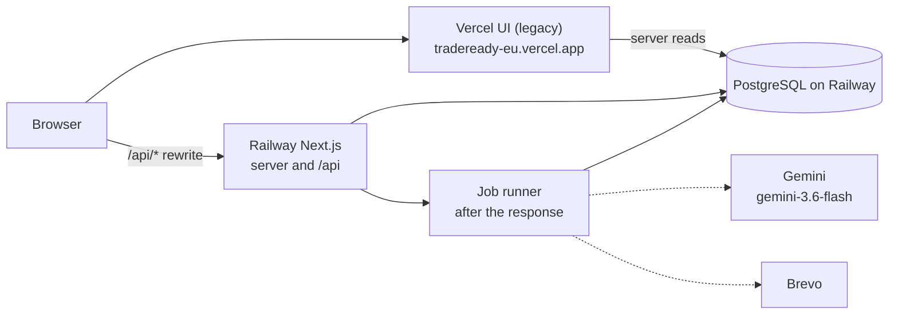

# TradeReady

**From Supplier Potential to Buyer Confidence.**

TradeReady turns a supplier's documents into a source-cited evidence report for one buyer's checklist. Gemini reads the text and returns observations with exact quotes. Deterministic rules decide each finding. The model never declares that a supplier is compliant, and the report has no score.

This repository is the Stuttgart hackathon build for 2026-11-07 (submission 16:45 Europe/Berlin). The paragraph above is the product. The sections below say what `main` actually does on that date, and what is still open.

Live app (pages and API): <https://tradeready-production.up.railway.app> (`GET /api/health` returns `{"ok":true}`).
The earlier Vercel front end, <https://tradeready-eu.vercel.app>, can no longer be redeployed on the free plan, so it may lag behind `main`. Use the Railway URL.

The public home page is still the starter landing. `/workspace` has no page on `main`, so the product screens are not in this deploy. See [In progress](#in-progress).

## What works on main

A signed-in user can use the APIs below. There is no product screen for them yet.

- **Sign-in.** Email and password through Better Auth. Google and GitHub buttons appear when those client keys are set. Every protected API checks the session. A missing session gets 401. Another user's product or job gets 404.
- **Documents.** `POST /api/products/[productId]/documents` accepts one file per request (PDF or photo), rejects anything over 4 MB, and stores it as pending. A pending file can replace an active one. Finalising a batch is a single transaction in the document service.
- **PDF text.** `unpdf` returns page-labelled text. A PDF with no text layer is flagged empty. Fixture tests check the datasheet grade, the certificate date and the inspection revision.
- **Rules and citations.** Findings are `DOCUMENTED`, `MISSING`, `MISMATCH`, `EXPIRED` or `NEEDS_REVIEW`. A quote that is not on the cited page is dropped. A wrong part never counts as support. An ISO date of 2026-08-01 is `EXPIRED` on the assessment date 2026-11-07. Requirements sit in four dimensions: Quality, Product and material, Traceability, Packaging and logistics. A dimension is a label, and it carries no percentage.
- **Jobs.** `POST /api/jobs` with `{ "productId" }` starts one job per document snapshot. The same snapshot returns the same job. `GET /api/jobs/[jobId]` returns status, stage, error and result id. A job stuck in `PROCESSING` for more than five minutes is re-queued, up to two attempts. The runner is scheduled with `after()` on the Railway process. Its body still throws `not implemented: runAssessment`, so a started job does not extract facts, save a result or send mail.
- **Gemini extraction library.** `extractFacts` asks `gemini-3.6-flash` for observations and quotes only, at temperature 0. Expected statuses are not sent to the model. Production keeps `GEMINI_API_KEY` on Railway. A live smoke of fixtures 01–04 on that model passed three times: document 03 yielded revision A with the quote "Drawing revision: A.", and document 02 yielded validity end 2026-08-01 with the quote "Valid until: 2026-08-01". That smoke is the extraction call, not a full assessment job.
- **Assistant API.** `POST /api/assistant` runs Gemini function calling for at most five rounds, and only the eight approved tools. A model-supplied product id the user does not own returns "not found" and the model is not called for that id. The chat panel component still renders nothing, and no page mounts it.
- **Completion email.** Brevo is called with `fetch` (`POST /v3/smtp/email`, 15 second timeout). The subject is "Your TradeReady assessment is ready". The body is text, with a link to `/workspace/<productId>/report` and no attachment. The team received one live completion email on 2026-11-07. That link does not open a report page yet. A missing Brevo key marks the notification failed with "email not configured" and leaves any stored result alone.
- **Deploy.** Vercel serves the UI and rewrites `/api/*` to Railway. Railway runs the Next.js server, the job runner and PostgreSQL. Migrations run on Railway before start. Vercel does not migrate.

The database already has `product`, `document`, `assessment_job`, `assessment_result`, `buyer_request`, `request_connection` and `notification`, with the ownership and status checks from the schema. The buyer-connection service functions still throw `not implemented`.

## In progress

These are open pull requests or unticked groups. They are not part of the running app.

| Work | Where it stands |
|---|---|
| Workspace, report and action plan | [PR #11](https://github.com/namnhatpham1995/hackathon-stuttgart-2026/pull/11) (`feat/workspace-ui`). `/workspace` is not a page on `main`. |
| Magic-link sign-in | [PR #20](https://github.com/namnhatpham1995/hackathon-stuttgart-2026/pull/20). Email and password remain the sign-in on `main`. |
| End-to-end assessment | Group 13. `runAssessment` is still the stub. No golden test file is on `main`. `pnpm test:golden` exits 0 because the config allows no tests. |
| Assistant chat panel | Group 14, task 14.3. The server route from PR #21 is on `main`. The panel is an empty slot. |
| Spoken replies | Group 15, optional. No speech route and no ElevenLabs call. |
| Buyer and supplier connections | [PR #22](https://github.com/namnhatpham1995/hackathon-stuttgart-2026/pull/22). The tables exist. The service on `main` throws. |
| Live roadmap page | Group 2. Not merged. |

When one of these merges, move that row into [What works on main](#what-works-on-main) and delete the caveat that no longer applies. Check the claim against the merged code before you do.

The demo the pitch describes, once 11, 13 and 17 are on `main`: fictional supplier Lotus Mould Co., Ltd. uploads documents for fictional buyer Neckar Maschinenbau GmbH against checklist `neckar-cap-104` (cover cap CAP-104, revision B). The answer key expects R1 documented, R2 expired, R3 mismatch (inspection revision A), R4 missing, R5 documented. Replacing the inspection file with revision B changes only R3. That click-through has not been run on `main`.

## Architecture



The solid arrows are the deploy on `main`. Vercel keeps the browser on one origin so the session cookie still works, and its server components read the same Railway Postgres. `GEMINI_API_KEY`, `BREVO_API_KEY` and `BREVO_SENDER_EMAIL` are set on Railway only.

The dotted arrows are the runner's designed calls. `scheduleAssessmentRun` does call `runAssessment`, and that function throws until group 13 merges, so those calls do not happen. The one live Brevo send was from a local notification row, not from this runner.

Details and rollback: [docs/deploy.md](docs/deploy.md).

## Tech stack

| Piece | Choice |
|---|---|
| App | Next.js 16 (App Router), React 19, Tailwind CSS 4 |
| Auth | Better Auth 1.7 (email and password; Google and GitHub when configured) |
| Database | PostgreSQL 16, Drizzle ORM, `postgres` driver |
| Validation | Zod 4 at route and service boundaries |
| Documents | `unpdf` for page text |
| Model | `@google/genai`, production model `gemini-3.6-flash` |
| Email | Brevo over `fetch`. No Brevo SDK |
| Voice | ElevenLabs is optional and not built |
| Quality | TypeScript, Biome, Vitest against PostgreSQL |
| Hosts | Vercel (UI), Railway (server, jobs, Postgres) |

Versions are the ranges in `package.json`. Node 22.12 or newer. pnpm 11.6 (`packageManager`).

## Local setup

Docker, Node 22.12+ and pnpm 11.

```bash
pnpm install
pnpm dev:setup
pnpm dev
```

Open <http://localhost:3001>. `pnpm dev:setup` writes `.env` with a fresh `BETTER_AUTH_SECRET`, starts PostgreSQL on port 5434, migrates, seeds the demo user and installs git hooks. The seeded account is `SEED_USER_EMAIL` and `SEED_USER_PASSWORD` in `.env`.

Leave `BACKEND_URL` unset locally so `/api/*` stays on the dev server. Do not point `DATABASE_URL` at Railway or any shared database.

| Command | What it does |
|---|---|
| `pnpm dev` | Dev server on `PORT` from `.env` (3001 in the main checkout) |
| `pnpm verify` | Typecheck, lint and tests. The pre-push hook and CI run this |
| `pnpm test:golden` | Hand-run golden tests. No golden file is on `main` yet |
| `pnpm db:up` | PostgreSQL in Docker on port 5434 |
| `pnpm db:generate` | New migration after a schema change |
| `pnpm db:migrate` / `pnpm db:seed` | Apply migrations / create the demo user |
| `pnpm worktree <type>/<slug>` | Feature branch in its own worktree, database and port |

Copy new keys into `src/env.ts` and `.env.example` only. Never commit `.env`.

## Deployment

Railway is the public site: it serves pages and `/api` from `main`. Vercel was the front end until its free deploy limit stopped new deploys on 2026-11-07. Follow [docs/deploy.md](docs/deploy.md) to recreate them.

- **Railway** (`tradeready-production.up.railway.app`, the public URL): Node 22, `pnpm build`, pre-deploy `pnpm db:migrate`, `pnpm start`, healthcheck `GET /api/health`. Private `DATABASE_URL`. Gemini and Brevo keys live here.
- **Vercel** (`tradeready-eu.vercel.app`, legacy, no new deploys): build `node scripts/vercel-build.mjs` (build only, no migrate). `BACKEND_URL` is the Railway origin. `DATABASE_URL` is Railway's public Postgres URL. `BETTER_AUTH_SECRET` matches Railway. Railway's `BETTER_AUTH_URL` and `APP_BASE_URL` are the Railway origin, so sign-in works only on the Railway URL.

Rollback is a Railway redeploy of the previous successful deployment, and a Vercel Promote of the previous production deployment. Migrations are additive.

## Fixtures

`fixtures/exportready/` holds fictional one-page PDFs for the Lotus Mould / CAP-104 demo. Every page except `empty.pdf` ends with `FICTIONAL DEMO DOCUMENT - NOT VALID FOR COMMERCIAL USE`. Regenerate them with `pnpm exec tsx scripts/make-fixtures.ts`.

`answer-key.json` is test-only. Do not send it, or any expected outcome in it, to the model. See [fixtures/exportready/README.md](fixtures/exportready/README.md).

## Tests

`pnpm verify` runs the tests that are on `main`, against a real PostgreSQL:

| File | What it checks |
|---|---|
| `src/lib/auth.test.ts` | Email and password sign-up and sign-in |
| `src/lib/safe-next-path.test.ts` | A post-login redirect stays on this site |
| `src/db/schema/exportready.test.ts` | A job cannot be `COMPLETED` without a result id |
| `src/lib/assessment/pdf-text.test.ts` | Fixture PDFs yield their key values; `empty.pdf` is flagged |
| `src/lib/assessment/extract-facts.test.ts` | A document the first pass omitted is retried |
| `src/lib/assessment/citations.test.ts` | An invented quote or unknown document is dropped |
| `src/lib/assessment/rules.test.ts` | Expiry, revision, wrong part, grade, packaging, traceability |
| `src/lib/jobs/jobs.test.ts` | One job per snapshot, unique index, other user's job is 404 |
| `src/lib/agent/assistant.test.ts` | Eight tools, session required, foreign product id, five-round cap |

The golden assessment (documents 01–04 versus the answer key, then the revision-B swap) is group 13 and is not in this tree.

## Screenshots

<!-- screenshots: add after group 11 merges -->

Add the workspace, the evidence report and the action plan here after group 11 is on `main`. Until then this deploy has no product screen to capture.

## Team

Phuong, Nam, and the other people on the team. Who did what:

<!-- owner: fill in each person's contribution. Do not invent this list. -->

- Phuong —
- Nam —
- —

## Known limits

- **Durability.** If the Railway process dies mid-job, the next status read re-queues a job that has been `PROCESSING` for more than five minutes, and it stops after two attempts. There is no external workflow engine.
- **Authenticity.** The pipeline reads text inside the uploaded file. It does not check that a certificate was issued by the named body, or that the file is unaltered.
- **No compliance claim.** A `DOCUMENTED` finding means the uploaded text matched that checklist row. It is not a legal, customs or market-access opinion.
- **No score.** The report lists statuses, a reason and a next action per requirement. It has no percentage and no pass mark.
- **Text PDFs.** A scan with no text layer is flagged empty. The result is then incomplete (`NEEDS_REVIEW`), once the runner exists.
- **Sharing.** A report is for the signed-in supplier. Sharing one result with one signed-in buyer is group 17 and is not on `main`. There is no public passport link.
- **Email.** Mail is sent after a result is stored, and a Brevo failure does not roll the result back. The report page in the link is still group 11.
- **Business model.** Who would pay is a hypothesis in [docs/exportready-passport-idea.md](docs/exportready-passport-idea.md). Willingness to pay has not been tested. Interview notes, when they exist, belong in [docs/pitch/customer-learning.md](docs/pitch/customer-learning.md).
